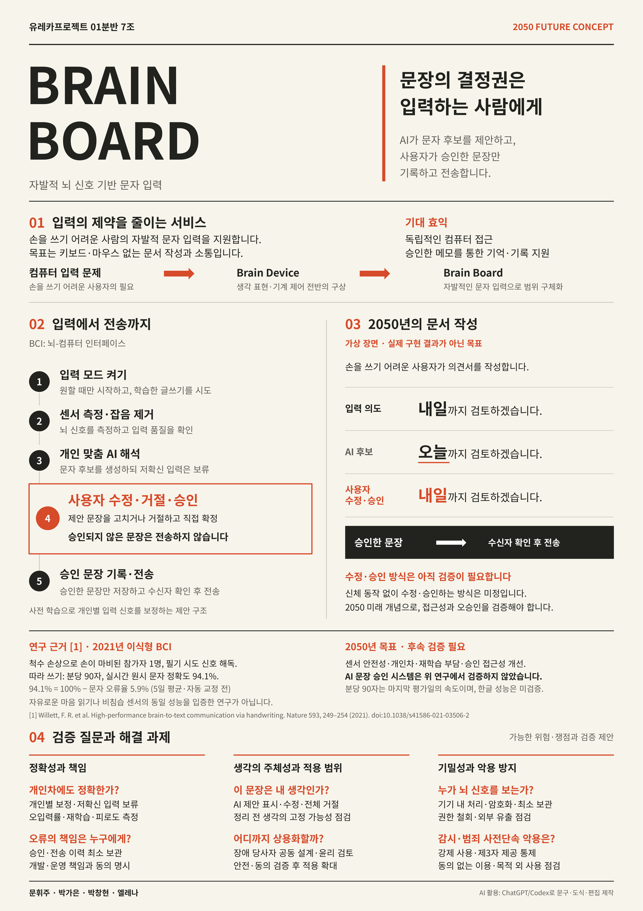

# Welcome to E26-SW01-07

## 🎯 팀 슬로건

> Discover. Develop. Deliver.

## 🖼️ 팀 포스터

<div class="poster"></div>


## 1️⃣ 팀원 소개

| **이름** | **전공** | **관심사** |
| --- | --- | --- |
| **문휘주** | 소프트웨어학부 | 클라이언트 코딩, 인공지능, 아이스 스케이팅 |
| **박가은** | 소프트웨어학부 | 백엔드, 자율주행, 임베디드 |
| **엘레나** | 소프트웨어학부 | 알고리즘, 시스템 프로그래밍, 스타트업 |
| **박창현** | 소프트웨어학부 | 인공지능, 자율주행, 사이버보안 |

유레카프로젝트 팀 생성을 축하합니다.
팀의 제목과 슬로건, 팀원의 이름 및 관심사를 변경하세요.

### 팀 소개

**반갑습니다!** 저희는 주변의 문제를 *발견*하고, 적절한 해결책을 *개발*하며, 아름다운 미래를 *전파*하는 팀, 유레카 7조 **Discover. Develop. Deliver.** 입니다.


***

## 2️⃣ 공통된 관심사 : 여행, 백엔드, 인공지능

***

## 3️⃣ 한학기 동안의 활동 내역 

- 기관/부서 인터뷰 ✔️  

- 현장 탐방 ✔️  

- 멘토링 ✔️  
  - 내 지도 교수 함게 만나기
  - 대학원 방문 및 선배 만나기

- 프로젝트 진행 ✔️  
  - 과거에 사람들이 상상한 미래
      1. 과거 사례 6가지
  
        -가정용 로봇 청소기/실현/기술이 실현되어 대중이 보편적으로 사용하고 있음

        -비행 가능 자동차/일부 실현/제주도에서 사용하는 사례가 있으나 대중화, 상용화되지는 않음
    
        -터치 스크린/실현/스마트폰 뿐 아니라 태블린, 칠판 까지 터치를 통해 조작이 가능해지고 사용됨
    
        -움직이는 도로/방향 전환/걷는 시간을 줄이는 것이 아닌 짐을 옮기는 무빙 워크로 전환되었고, 널리 설치된 도로와는 달리 일부 장소에 한정해 지어져 일부 실현의 성격을 보임
    
        -원격 수술/일부 실현/기술 구현은 되어있으나, 아직 상용화되지 않고 개발 단계에 있음
    
        -코닝 유리 태블릿(완전 유리 태블릿)/아직 미실현/터치 스크린은 현재도 가능하나, 전자 장치가 보이지 않은 채 완전히 비치는 태블릿을 구현했다기엔 여전히 기술적 문제가 존재
    

  - 그들과 AI가 만들어가는 세상
      1. 대학 생활에서 겪은 문제점이나 불편함들
   
         -공학관, 미래관, 예술관 등 내부 구조가 복잡한 건물에서 특정 강의실이나 교수님 연구실 등을 찾는 것이 어려움
 
         -식당을 직접 가기 전까진 식당 내 인원 수와 메뉴의 품절 여부를 확인할 수 없음

      -> AI를 통한 문제의 추상화, 구체화

  - 우리가 상상한 미래
 
      ‘브레인 보드(BRAIN BOARD)’는 손을 쓰기 어려운 사람이 자발적인 뇌 신호로 문서를 작성하고 소통하도록 돕는 2050년 미래 서비스 구상. 생각 표현과 기계 제어 전반을 다루던 ‘브레인 디바이스’에서 출발해, 사용자가 문장의 최종 결정권을 갖는 문자 입력 서비스로 범위를 구체화함.

    - 현재의 불편: 손을 쓰기 어려운 사람은 키보드와 마우스를 이용한 문서 작성에 제약을 겪음. 자신의 의사를 직접 표현하고 기록하려면 개인의 신체 조건에 맞는 입력 수단이 필요함.

    - 미래의 변화: 사용자가 글쓰기를 시도할 때 발생하는 뇌 신호를 문자 후보로 변환하고, AI가 제안한 표현을 사용자가 수정·거절·승인함. 승인한 문장만 기록하고 수신자를 확인한 뒤 전송하는 것이 목표.

    - 필요한 기술: 자발적인 입력 신호를 측정하는 뇌-컴퓨터 인터페이스(BCI), 개인별 신호를 해석하는 AI, 사용자가 쉽게 수정·승인할 수 있는 인터페이스가 필요함. 신체 동작 없이 수정·승인하는 구체적인 방식은 아직 정해지지 않았으며, 접근성과 신뢰성을 검증해야 함.

    - 남은 위험: 개인과 사용 환경에 따라 신호 해석의 정확도가 달라질 수 있고, AI가 사용자의 뜻과 다른 문장을 제안할 수 있음. 잘못 전송된 문장의 책임, 신경정보 유출, 동의 없는 감시와 악용도 검토해야 함. 따라서 사용자 통제권과 정보 보호를 핵심 설계 원칙으로 삼음.
   
    ※ 실제 구현 결과가 아닌 미래 개념이며, 센서의 안전성·입력 정확도·승인 절차의 실효성은 후속 검증이 필요함.


  - 우리가 그리는 미래 그리고 나

- 각오와 소감 나누기 ✔️  


<!-- 활동 사진 추가 예시 -->


***

## 4️⃣ 인상 깊은 활동

- 활동명 – 활동에 대한 간단한 설명과 배운 점을 작성  
- 예: 멘토링에서 실리콘밸리 현업 경험을 들을 수 있어 진로 방향 설정에 큰 도움이 되었다.  

***

## 5️⃣ 특별히 알아보고 싶은 것
- 예: 현장실습 제도
- 예: 학부 졸업 인증 조건
- 예: 성취기반평가
- 예: 졸업 후 진로(대학원/취업)

***

## 6️⃣ 활동을 마친 소감

🔗학번 이름  
> "소감 내용을 여기에 작성합니다."

🔗학번 이름  
> "소감 내용을 여기에 작성합니다."

🔗학번 이름  
> "소감 내용을 여기에 작성합니다."

🔗학번 이름  
> "소감 내용을 여기에 작성합니다."

🔗학번 이름  
> "소감 내용을 여기에 작성합니다."


## Markdown을 사용하여 내용꾸미기를 익히세요.

Markdown은 작문을 스타일링하기위한 가볍고 사용하기 쉬운 구문입니다. 여기에는 다음을위한 규칙이 포함됩니다.

```markdown
Syntax highlighted code block

# Header 1
## Header 2
### Header 3

- Bulleted
- List

1. Numbered
2. List

**Bold** and _Italic_ and `Code` text

[Link](url) and 
```

자세한 내용은 [GitHub Flavored Markdown](https://guides.github.com/features/mastering-markdown/).

### Support or Contact

readme 파일 생성에 추가적인 도움이 필요하면 [도움말](https://help.github.com/articles/about-readmes/) 이나 [contact support](https://github.com/contact) 을 이용하세요.

